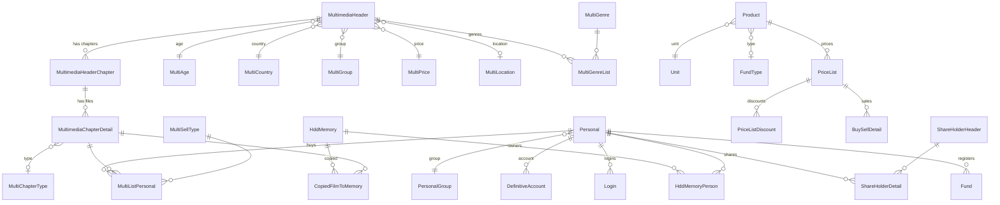

[<div dir="rtl">

# سیستم مدیریت فروشگاه کلوپ (Club Store Management System)

برنامه‌ی دسکتاپ ویندوزی برای مدیریت کلوپ فیلم: موجودی فیلم‌ها، تشخیص فلش، انتقال فایل به فلش مشتری، صدور فاکتور و انتشار «فیلم‌های جدید» به‌صورت صفحه‌ی وب برای مشتری‌ها.

پروژه‌ی تک‌نفره، ساخته‌شده با C#، Windows Forms، EF Core و SQL Server.

## امکانات

- **موجودی فیلم**: نام فارسی/انگلیسی، سال، کشور، ژانر، بازیگران، IMDB، توضیحات، رده‌ی سنی، فصل‌ها و قسمت‌ها
- **تشخیص فلش**: شناسایی فلش با شماره‌ی سریال و اتصال آن به مشتری
- **انتقال فایل**: کپی فیلم‌های انتخاب‌شده روی فلش مشتری و ثبت آنچه کپی شده
- **فاکتور و حساب**: لیست خرید مشتری، لیست قیمت با تخفیف تعدادی، صندوق و حساب معین
- **صفحه‌ی فیلم‌های جدید**: انتخاب چند فیلم در برنامه و انتشار آن‌ها به‌صورت سایت استاتیک (آپلود FTP)
- **ربات تلگرام کانال**: اعضای کانال و فاکتورها

## تصاویر برنامه
### گالری تصاویر برنامه
### 📸 تصاویر برنامه


|  |  |  |
|  |  |  |
|  |  |  | |

## تکنولوژی‌ها

C# / .NET، Windows Forms، Entity Framework Core، SQL Server، HTML/JS ساده برای صفحه‌ی منتشرشده، FTP

## صفحه‌ی فیلم‌های جدید

صفحه به‌صورت سایت استاتیک روی MonsterASP میزبانی می‌شود و با FTP آپلود می‌شود.

```
/
├── index.html        # صفحه‌ی ثابت با اسلایدر خودکار
├── 1/
│   ├── data.json
│   └── poster.jpg
├── 2/
│   └── ...
```

- `index.html` یک صفحه‌ی ثابت است: هدر چرخان و تصاویر کوچک برای جابه‌جایی
- هر پست یک پوشه‌ی شماره‌دار با `data.json` و پوستر است
- باز کردن پست با `index.html?p=3`
- پوسترها قبل از آپلود به کمتر از ۳۰۰ کیلوبایت کوچک می‌شوند
- نمایش: ژانرها، امتیاز، سال، مدت، بازیگران، خلاصه، برچسب کشور (ایران، آمریکا، هند، ترکیه، ژاپن، چین، کره)، برچسب انیمیشن/انیمه (سینمایی یا سریال) و برچسب ثابت «دوبله فارسی»

## دیتابیس

روش Code-first با EF Core. گروه‌های اصلی جدول‌ها:

| گروه | جدول‌ها |
|---|---|
| فیلم‌ها | `MultimediaHeader`، `MultimediaHeaderChapter`، `MultimediaChapterDetail`، `MultiGenre`، `MultiGenreList`، `MultiActor`، `MultiAge`، `MultiCountry`، `MultiGroup`، `MultiLocation`، `MultiPrice`، `MultiChapterType`، `MultiSellType` |
| مشتری و فروش | `Personal`، `PersonalGroup`، `MultiListPersonal`، `DefinitiveAccount`، `Login` |
| فلش | `HddMemory`، `HddMemoryPerson`، `CopiedFilmToMemory` |
| کالا و قیمت | `Product`، `Unit`، `FundType`، `PriceList`، `PriceListDiscount`، `BuySellDetail`، `SalesService` |
| صندوق و سهام‌داران | `Fund`، `ShareHolderHeader`، `ShareHolderDetail` |
| دسترسی، لینک، ربات | `AccessType`، `AccessList`، `LinkHeader`، `LinkDetail`، `BFactorHeader`، `BFactorDetail`، `ChanelMember` |
| لاگ | `ErrorExcep` |

### رابطه‌های اصلی



هر فیلم یک `MultimediaHeader` است. فیلم فصل‌ها (`MultimediaHeaderChapter`) دارد و هر فصل یک یا چند فایل (`MultimediaChapterDetail`، با پرچم‌هایی مثل WEB-DL یا HDTS). مشتری فایل‌ها را از طریق `MultiListPersonal` می‌خرد و کپی روی فلش در `CopiedFilmToMemory` ثبت می‌شود.

## راه‌اندازی

1. ریپو را clone کنید و فایل `.sln` را در Visual Studio باز کنید.
2. رشته‌ی اتصال SQL Server را در تنظیمات برنامه وارد کنید (هرگز آن را commit نکنید).
3. Migrationها را اجرا کنید یا دیتابیس را بسازید.
4. کلید `F5` را بزنید.

## مجوز

_مجوز پروژه را اینجا اضافه کنید._

## سازنده

مجتبی یادآور (Mojtaba Yadavar)

</div>
](https://raw.githubusercontent.com/MYadavar1991/IranKavosh2026/master/docs/screenshots/main1.png)
